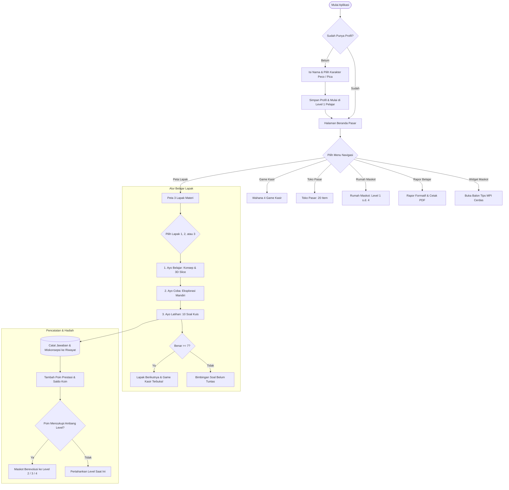
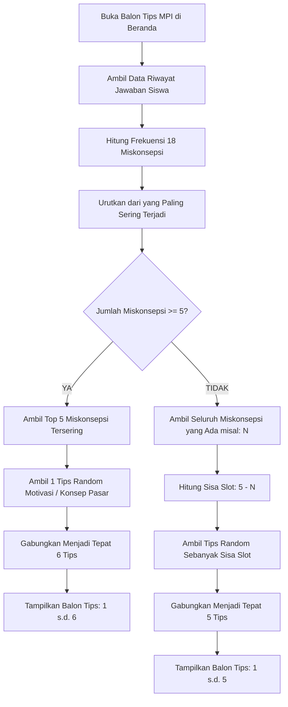
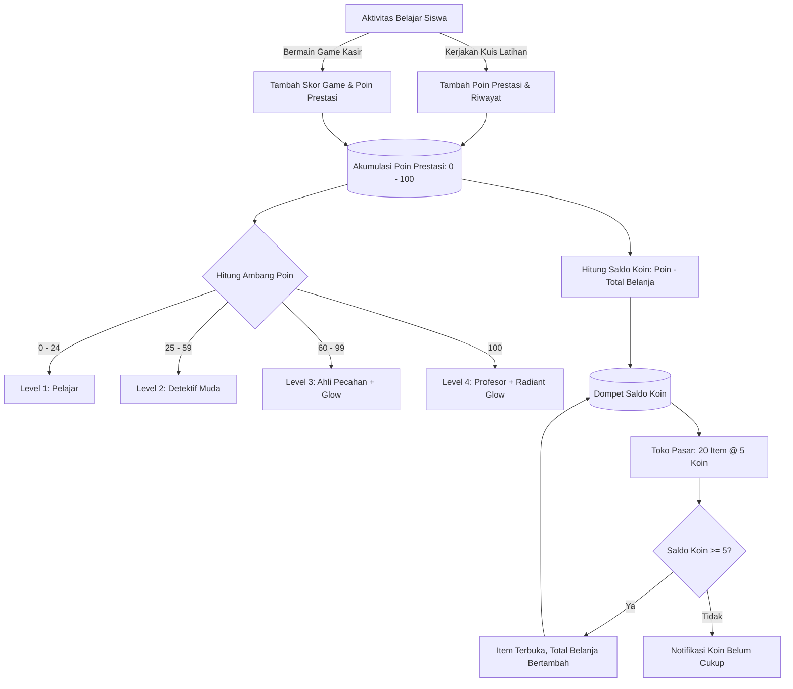
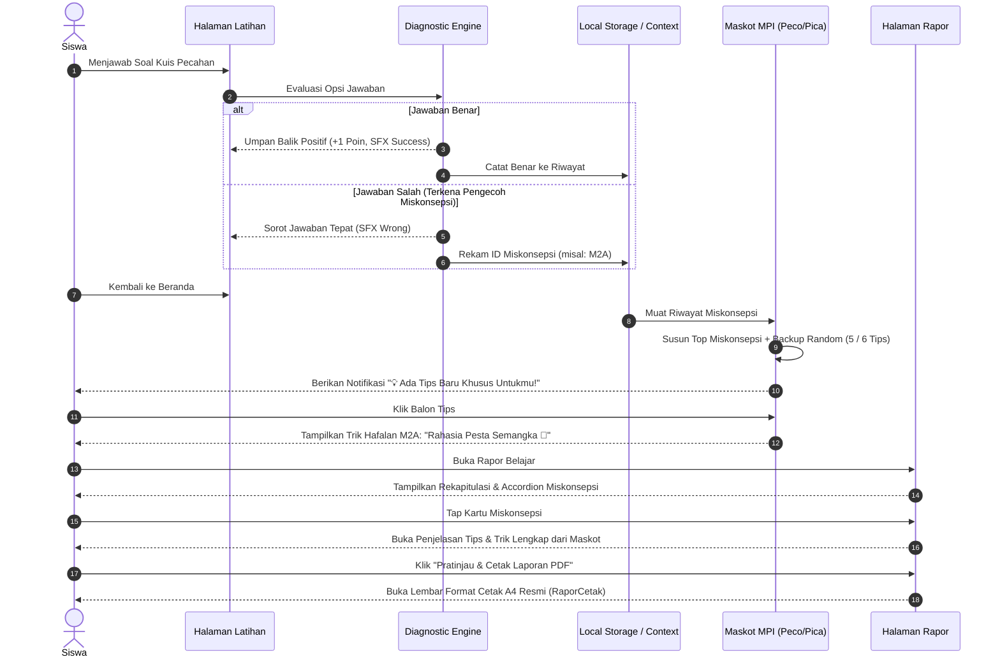

# DOKUMENTASI LENGKAP & BUKU PANDUAN SISTEM
# PECAH-IN: Petualangan Pecahan di Pasar Tradisional

> **Versi Aplikasi:** 0.1.0 (FIP Championship 2026 Edition)  
> **Platform Sasaran:** Web Responsive (Desktop/Tablet/Smartphone) & Native Android Mobile App (via Capacitor 7, Android SDK 34)  
> **Target Pengguna:** Siswa Sekolah Dasar Kelas 3 & 4 (Fase B Kurikulum Merdeka), Guru Matematika SD, serta Orang Tua/Pendamping Belajar.

---

## DAFTAR ISI
1. [Ringkasan Eksekutif & Filosofi Pedagogis](#1-ringkasan-eksekutif--filosofi-pedagogis)
2. [Matriks Kesiapan Fitur (Feature Readiness Matrix)](#2-matriks-kesiapan-fitur-feature-readiness-matrix)
3. [Tech-Stack & Arsitektur Teknologi](#3-tech-stack--arsitektur-teknologi)
4. [Modul Lapak Materi & Pembelajaran 3 Tahap](#4-modul-lapak-materi--pembelajaran-3-tahap)
5. [Fitur Visual 3D Interaktif (Three.js)](#5-fitur-visual-3d-interaktif-threejs)
6. [Sistem Progresi & Mekanisme Unlock Game](#6-sistem-progresi--mekanisme-unlock-game)
7. [Sistem Ekonomi Dual-Currency & Katalog 20 Item Toko](#7-sistem-ekonomi-dual-currency--katalog-20-item-toko)
8. [Sistem Evolusi Maskot (Peco & Pica Level 1–4)](#8-sistem-evolusi-maskot-peco--pica-level-14)
9. [MPI (Maskot Pendamping Interaktif) & Remedial Miskonsepsi](#9-mpi-maskot-pendamping-interaktif--remedial-miskonsepsi)
10. [Sistem Rapor Belajar & Ekspor Laporan PDF](#10-sistem-rapor-belajar--ekspor-laporan-pdf)
11. [Desain Antarmuka: Tema Treasure Scroll Map](#11-desain-antarmuka-tema-treasure-scroll-map)
12. [Kumpulan Diagram & Flowchart Cara Kerja Aplikasi](#12-kumpulan-diagram--flowchart-cara-kerja-aplikasi)

---

## 1. RINGKASAN EKSEKUTIF & FILOSOFI PEDAGOGIS

**PECAH-IN** adalah Multimedia Pembelajaran Interaktif (MPI) matematika yang dirancang khusus untuk mengatasi problematika tingginya miskonsepsi siswa sekolah dasar dalam memahami pecahan.

### Landasan Teori Pendidikan
1. **Realistic Mathematics Education (RME):** Konsep pecahan tidak disajikan secara formal abstrak ($\frac{a}{b}$), melainkan dibumikan melalui aktivitas kontekstual di pasar tradisional Nusantara: membagi semangka segar sama rata, menata loyang kue tart lapak, membandingkan timbangan buah, dan melayani belanjaan pembeli.
2. **Contextual Teaching and Learning (CTL):** Menghubungkan matematika dengan kehidupan nyata anak, membangun pemahaman intuitif bahwa pecahan lahir dari kebutuhan pembagian yang adil (*equal parts*).
3. **Formative Diagnostic Assessment:** Aplikasi tidak hanya mencatat skor angka, melainkan **mendiagnosis jenis miskonsepsi kognitif spesifik** dari setiap jawaban salah yang dipilih anak, kemudian memberikan intervensi *remedial learning* otomatis melalui Agen Pedagogis (Maskot Pendamping).

---

## 2. MATRIKS KESIAPAN FITUR (FEATURE READINESS MATRIX)

Untuk menjamin transparansi teknis dan kemudahan verifikasi oleh dewan juri, berikut adalah status implementasi aktual seluruh fitur:

| Modul / Fitur | Kategori | Status Implementasi | Catatan Verifikasi Kode |
| :--- | :--- | :---: | :--- |
| **3 Lapak Materi (Belajar, Coba, Latihan)** | Pembelajaran | ✅ **Implemented** | Selesai 100%, kriteria lulus 7/10 soal (`MateriDetail.tsx`). |
| **Visualisasi 3D Interaktif (Three.js)** | Grafika WebGL | ✅ **Implemented** | Semangka, kue tart, dan balok modular dengan swipe-cut (`Fraction3DSlice.tsx`). |
| **4 Game Kasir Pasar** | Gamifikasi | ✅ **Implemented** | `g1` Bagi Rata, `g2` Banding, `g3` Lapak Jualan, `gCampuran` (`Game.tsx`). |
| **Evolusi Maskot Level 1–4** | Gamifikasi | ✅ **Implemented** | Level 1 Pelajar s.d. Level 4 Profesor, level 0 ditiadakan (`Mascot.tsx`). |
| **Pendaran Cahaya Maskot (Soft-Glow)** | Visual FX | ✅ **Implemented** | Ambient glow CSS blur aktif di Level 3 & Level 4 (`Mascot.tsx`). |
| **Diagnosis 18 Miskonsepsi Pecahan** | Pedagogis | ✅ **Implemented** | Terpetakan di bank soal dan modul diagnosis (`content.ts`, `diagnosis.ts`). |
| **MPI Cerdas (Aturan Kuota 5/6 Tips)** | Pedagogis | ✅ **Implemented** | Prioritas miskonsepsi siswa + backup tips random (`miskonsepsi-tips.ts`, `Home.tsx`). |
| **Toko Pasar (Katalog 20 Item)** | Gamifikasi | ✅ **Implemented** | 6 Buah, 8 Kue/Makanan, 6 Suvenir seharga 5 koin (`content.ts`, `Toko.tsx`). |
| **Model Ekonomi Dual-Currency** | Sistem Akun | ✅ **Implemented** | Poin EXP kumulatif maskot & Koin belanja dinamis (`profil-context.tsx`). |
| **Rapor Belajar In-App (Accordion Tips)** | Evaluasi | ✅ **Implemented** | Analisis 3 domain + tap miskonsepsi untuk buka tips (`Rapor.tsx`). |
| **Cetak PDF Lembar Asesmen Formal A4** | Evaluasi | ✅ **Implemented** | Kop resmi, grafik domain, rekomendasi otomatis, TTD (`RaporCetak.tsx`). |
| **Audio Engine (SFX Prosedural + BGM)** | Multimedia | ✅ **Implemented** | Web Audio API SFX synth + pemutar `market-bgm.mp3` (`audio.ts`). |
| **Narasi Soal Suara (TTS)** | Aksesibilitas | ✅ **Implemented** | Web Speech API SpeechSynthesis bahasa Indonesia (`audio.ts`). |
| **Paket Android Native APK** | Platform | ✅ **Implemented** | Capacitor 7 terintegrasi dengan Gradle Android SDK 34. |
| **PWA Offline Service Worker Cache** | Platform | 🔜 *Planned Roadmap* | Direncanakan pada rilis versi 0.2.0 mendatang. |

---

## 3. TECH-STACK & ARSITEKTUR TEKNOLOGI

Aplikasi dibangun dengan standar rekayasa perangkat lunak modern untuk menjamin performa tinggi, efisiensi memori, dan kompatibilitas perangkat mobile:

| Lapisan Sistem | Teknologi | Keterangan & Rationale |
| :--- | :--- | :--- |
| **Framework Utama** | **React 19 (TypeScript)** | Memanfaatkan rendering deklaratif, *strict type safety*, dan arsitektur komponen modular. |
| **Bundler & Build Tool** | **Vite 6** | Menyediakan *Hot Module Replacement* (HMR) sub-detik dan kompilasi build produksi super ramping. |
| **Styling & Desain** | **Tailwind CSS v4** | Desain responsif bertema kustom (*Treasure Scroll Map*, kayu jati tua, dan ornamen pasar Nusantara). |
| **Grafika 3D Interaktif** | **Three.js (WebGL)** | Rendering 3D manipulatif konkret (semangka potong, kue tart, balok kue) yang dapat digeser dan dipotong interaktif. |
| **State Management** | **Zustand + React Context** | Manajemen state reaktif terpusat dengan sinkronisasi otomatis ke `localStorage` (profil, riwayat kuis, inventori toko, koin, poin). |
| **Audio Engine** | **Web Audio API + HTML5 Audio** | Pembangkit SFX prosedural (*synthesizer* nada menang, gagal, klik kayu, pop) dan pemutar *Market BGM* ramah anak. |
| **Aksesibilitas Suara** | **Web Speech API (TTS)** | Pembaca narasi soal otomatis dalam Bahasa Indonesia ramah anak. |
| **Routing System** | **Custom Hash/State Router** | Navigasi halaman cepat berbasis state tanpa ketergantungan server hosting, optimal untuk mode offline APK. |
| **Pelaporan Dokumen** | **jsPDF & CSS Print Engine** | Pembuatan berkas PDF rapor formatif di sisi klien (*client-side*) secara instan dengan pratinjau cetak A4. |
| **Mobile Deployment** | **Capacitor 7 (Android SDK 34)** | Memaketkan aplikasi web menjadi berkas APK Android siap pasang di smartphone/tablet siswa. |

---

## 4. MODUL LAPAK MATERI & PEMBELAJARAN 3 TAHAP

Materi pembelajaran dipecah menjadi 3 lapak utama dengan struktur progresif:

### Lapak 1: Kenal Pecahan & Bagi Rata (Domain: Konsep)
* **Fokus Kompetensi:** Memahami pecahan sebagai bagian dari keseluruhan yang utuh, syarat mutlak pembagian adil (*equal parts*), serta mengenali letak dan arti pembilang dan penyebut.
* **Metafora Pasar:** Memotong buah semangka bulat utuh di lapak buah Pak Peco.

### Lapak 2: Banding, Urut & Pecahan Senilai (Domain: Prinsip)
* **Fokus Kompetensi:** Membandingkan pecahan berpenyebut sama, membandingkan pecahan berpenyebut berbeda (misal $\frac{1}{4}$ vs $\frac{1}{8}$), mengurutkan pecahan, serta membuktikan kesamaan nilai pecahan senilai ($\frac{1}{2} = \frac{2}{4} = \frac{3}{6}$).
* **Metafora Pasar:** Memotong dan menata loyang kue tart lapak Bu Pica.

### Lapak 3: Jumlah & Cerita Pasar (Domain: Prinsip & Verbal)
* **Fokus Kompetensi:** Operasi penjumlahan pecahan berpenyebut sama ($\frac{a}{b} + \frac{c}{b} = \frac{a+c}{b}$), memahami bahwa penyebut tidak ikut dijumlahkan, serta memecahkan soal cerita kontekstual bertransaksi di pasar.
* **Metafora Pasar:** Menggabungkan pesanan kue balok dari para pembeli pasar.

---

### Struktur Pembelajaran 3 Tahap di Tiap Lapak:
```
┌─────────────────────────────────────────────────────────────┐
│ 1. AYO BELAJAR                                              │
│ • Kartu teori visual interaktif                             │
│ • Manipulasi objek 3D konkret dengan irisan dinamis         │
│ • Simulasi pembagian adil (⚖️ Sama Besar vs ❌ Beda Ukuran)  │
└──────────────────────────────┬──────────────────────────────┘
                               ▼
┌─────────────────────────────────────────────────────────────┐
│ 2. AYO COBA                                                 │
│ • Simulasi mandiri bebas (*hands-on playground*)            │
│ • Eksplorasi memotong benda menjadi 2 hingga 8 bagian       │
│ • Mengarsir interaktif dan melihat pecahan senilai          │
└──────────────────────────────┬──────────────────────────────┘
                               ▼
┌─────────────────────────────────────────────────────────────┐
│ 3. AYO LATIHAN                                              │
│ • 10 butir soal adaptif berstandar pedagogis                │
│ • Peta kemajuan soal interaktif (1 s.d. 10)                 │
│ • Fitur dengarkan narasi suara (*text-to-speech audio*)     │
│ • Alat arsir sentuh layar (*interactive shape coloring*)    │
│ • Umpan balik diagnostik seketika                           │
└─────────────────────────────────────────────────────────────┘
```

---

## 5. FITUR VISUAL 3D INTERAKTIF (THREE.JS)

Salah satu keunggulan utama PECAH-IN adalah integrasi grafika **Three.js** melalui komponen [`Fraction3DSlice.tsx`](file:///Users/macproi52019/Documents/PECAH-IN/pecah-in/src/components/Fraction3DSlice.tsx):

1. **Model Semangka 3D Procedural (`semangka`):**
   - Kulit semangka hijau zamrud solid (`#15803d`) dengan lapisan dalam putih gading (`#fef9c3`).
   - Daging merah cerah (`#e11d48`) dengan biji-biji wijen hitam 3D yang diposisikan secara prosedural.
   - Irisan pecahan terpisah (*exploded radial view*) saat anak memilih jumlah bagian tertentu.
2. **Model Kue Tart 3D (`kue-tart`):**
   - Tekstur kue tart dengan lapisan selai manis, pinggiran crust mentega, dan taburan meses ceria (*sprinkles*).
   - Potongan kue terangkat secara visual saat disentuh untuk membuktikan ukuran sudut busur irisan ($\theta = \frac{2\pi}{n}$).
3. **Model Balok Modular (`kue-batang` / `cokelat`):**
   - Model geometri balok modular untuk mendemonstrasikan penjumlahan pecahan berpenyebut sama secara konkret.
4. **Interaksi Potong Pisau (Swipe-to-Cut Gesture):**
   - Anak dapat mengusap layar menggunakan jari/mouse untuk memicu aksi pemotongan semangka secara nyata layaknya pedagang pasar!

---

## 6. SISTEM PROGRESI & MEKANISME UNLOCK GAME

Aplikasi menerapkan sistem pembukaan bertahap (*gating progression system*) yang menjaga alur belajar anak tetap terarah:

```
[Lapak Materi 1] ───(Lulus 7/10 Soal)───► [Lapak 2 Terbuka & Game 1 Terbuka]
      │
      ▼
[Lapak Materi 2] ───(Lulus 7/10 Soal)───► [Lapak 3 Terbuka & Game 2 Terbuka]
      │
      ▼
[Lapak Materi 3] ───(Lulus 7/10 Soal)───► [Game 3 Terbuka & Tantangan Campuran]
```

### Kriteria Kelulusan Materi:
- Masing-masing lapak memiliki **10 soal latihan**.
- Siswa dinyatakan lulus lapak apabila menjawab benar minimal **7 dari 10 soal** ($\ge 70\%$).
- Setelah lulus, lapak materi berikutnya dan wahana permainan kasir terkait akan otomatis terbuka (*unlocked*).

### 4 Modul Permainan Kasir Pasar (`GAMES` di `content.ts`):
1. **`g1`: Bagi Rata & Cocok (Simulasi Potong Semangka Kasir):**  
   Pelanggan pasar datang memesan porsi buah tertentu (misal: "Beli $\frac{3}{4}$ semangka ya!"). Anak memotong dan mencocokkan semangka 3D sesuai pesanan secara tepat waktu.
2. **`g2`: Banding & Jodoh (Simulasi Timbang & Bandingkan Kue):**  
   Pelanggan meminta porsi yang lebih besar atau mencari kue yang senilai. Anak menempatkan porsi kue ke atas timbangan pasar.
3. **`g3`: Lapak Jualan (Simulasi Gabung Pesanan Pembeli):**  
   Pelanggan membeli beberapa porsi pecahan sekaligus. Anak menjumlahkan pesanan tersebut dengan benar untuk melayani antrean pembeli.
4. **`gCampuran`: Tantangan Campuran (Ujian Akhir Saudagar Pasar):**  
   Terbuka setelah seluruh materi tuntas. Menguji kelincahan anak menyelesaikan berbagai variasi pesanan pasar secara terpadu.

---

## 7. SISTEM EKONOMI DUAL-CURRENCY & KATALOG 20 ITEM TOKO

Untuk memberikan motivasi belajar berkelanjutan tanpa merusak metrik evaluasi anak, PECAH-IN menerapkan sistem **Dual-Currency (Poin Prestasi vs Koin Belanja)**:

### 1. Perbedaan Mendasar Poin vs Koin:
* **Poin Prestasi Kumulatif (Lifetime EXP, 0–100 Poin):**  
  Diperoleh dari ketuntasan latihan lapak (maksimal 30 poin) dan perolehan skor game kasir (maksimal 70 poin). Poin ini bersifat permanen dan **TIDAK PERNAH BERKURANG** saat belanja. Poin ini menjadi penentu mutlak **Tingkat Evolusi Maskot (Level 1–4)**.
* **Koin Belanja Pasar (Saldo Belanja Dinamis):**  
  Saldo likuid yang dapat dibelanjakan anak untuk membeli item di Toko Pasar. Dihitung secara konsisten melalui formula:
  $$\text{Saldo Koin} = \max\Big(0, \text{Total Poin Prestasi} - \text{Total Koin Dibelanjakan}\Big)$$
  *Keunggulan Pedagogis:* Anak bebas membelanjakan koin untuk mengoleksi barang toko tanpa perlu cemas level maskotnya akan turun kembali!

---

### 2. Katalog Lengkap 20 Item Toko Pasar (@ 5 Koin):
Seluruh item dapat dibeli di Toko Pasar dengan harga seragam **5 Koin**:

#### A. Kategori Buah Segar (6 Item):
1. 🍉 **Semangka** (`buah-semangka`): Potongan semangka segar 1/4 bagian.
2. 🍊 **Jeruk Manis** (`buah-jeruk`): Jeruk potong 1/2 bagian segar.
3. 🍎 **Apel Merah** (`buah-apel`): Apel renyah manis segar.
4. 🍌 **Pisang Saji** (`buah-pisang`): Pisang olahan pedagang pasar.
5. 🍇 **Anggur Manis** (`buah-anggur`): Anggur manis segar ranum.
6. 🍍 **Nanas Potong** (`buah-nanas`): Nanas madu potong 1/8 bagian.

#### B. Kategori Kue & Jajanan Pasar (8 Item):
7. 🍰 **Kue Tart** (`kue-tart`): Tart pelangi lezat 1/6 loyang.
8. 🍕 **Pizza Keju** (`kue-pizza`): Pizza keju gurih 1/8 bagian.
9. 🍞 **Roti Gandum** (`kue-roti`): Roti gandum sehat 1/4 bagian.
10. 🍫 **Cokelat Batang** (`kue-cokelat`): Cokelat manis lapak kue.
11. 🍩 **Donat Manis** (`kue-donut`): Donat gula manis 1/2 bagian.
12. 🧁 **Cupcake** (`kue-cupcake`): Cupcake hiasan cantik.
13. 🥞 **Pancake Madu** (`kue-pancake`): Pancake sarapan lezat.
14. 🧇 **Waffle Garing** (`kue-waffle`): Waffle renyah hangat.

#### C. Kategori Suvenir Pedagang (6 Item):
15. ⚖️ **Timbangan Adil** (`souvenir-timbangan`): Timbangan pasar adil tanpa curang.
16. 🏆 **Piala Juara** (`souvenir-trofi`): Trofi kasir cilik teladan.
17. 🧑‍🍳 **Topi Koki** (`souvenir-topi`): Topi koki pedagang hebat.
18. 👑 **Mahkota Saudagar** (`souvenir-mahkota`): Mahkota kebanggaan juragan pasar.
19. 🥇 **Medali Emas** (`souvenir-medali`): Medali prestasi pecahan pasar.
20. 🛍️ **Tas Belanja** (`souvenir-kantong`): Tas belanja ramah lingkungan.

---

## 8. SISTEM EVOLUSI MASKOT (PECO & PICA LEVEL 1–4)

Siswa memilih avatar maskot sejak awal petualangan:
- 👦 **Peco:** Pedagang cilik ramah dengan topi petualang dan celemek hijau toska.
- 👧 **Pica:** Pedagang cilik ceria dengan topi caping pita kuning dan celemek oranye.

Tingkatan level maskot resmi dimulai dari **Level 1** sampai **Level 4** (Level 0 ditiadakan total):

| Level | Gelar Maskot | Syarat Poin | Ciri Visual Karakter | Efek Visual Aura |
| :---: | :--- | :---: | :--- | :--- |
| **1** | **Pelajar** | $0 - 24$ Poin | Seragam magang kasir cilik, melambaikan tangan ramah. | Standar Bersih |
| **2** | **Detektif Muda** | $25 - 59$ Poin | Memegang kaca pembesar, menyematkan lencana bintang detektif. | Standar Detektif |
| **3** | **Ahli Pecahan** | $60 - 99$ Poin | Memakai mahkota emas permata zamrud dan celemek juragan. | **Ambient Soft Glow Amber (`blur-lg`)** |
| **4** | **Profesor** | $100$ Poin *(Maks)* | Mengenakan jubah sultan beludru merah berenda emas, kacamata emas, dan mahkota agung. | **Radiant Golden Glow (`blur-xl`)** |

---

## 9. MPI (MASKOT PENDAMPING INTERAKTIF) & REMEDIAL MISKONSEPSI

Fitur MPI bertindak sebagai **agen pedagogis adaptif** yang mendampingi anak secara personal.

### 1. Bank Data 18 Miskonsepsi Pecahan SD
Sistem mendeteksi 18 pola kesalahan kognitif baku ([`miskonsepsi-tips.ts`](file:///Users/macproi52019/Documents/PECAH-IN/pecah-in/src/lib/miskonsepsi-tips.ts)):
* **M1A – M1E:** Salah hitung arsir, tertukar pembilang/penyebut, anggapan asal bagi pasti pecahan, bagian tak sama besar dianggap sah, salah baca cerita.
* **M2A – M2G:** Anggapan penyebut besar berarti pecahan besar, menolak banding penyebut beda, salah cara samakan penyebut, pecahan senilai dianggap beda nilai, salah urutan, salah arah buaya $(>)$.
* **M3A – M3F:** Penyebut ikut dijumlah ($\frac{1}{4}+\frac{2}{4}=\frac{3}{8}$), penyebut diubah paksa, salah kata kunci sisa/tambah, salah salin satu suku, operasi tertukar kurang.

---

### 2. Logika Penjatahan Kuota Tips (Saling Backup Dinamis)
Balon dialog maskot di Beranda diatur dengan algoritma adaptif:

```
                  ┌──────────────────────────────┐
                  │ Periksa Riwayat Kuis Siswa   │
                  └──────────────┬───────────────┘
                                 │
                   Apakah Miskonsepsi >= 5?
                                 │
                 ┌───────────────┴───────────────┐
             YA  │                               │ TIDAK
                 ▼                               ▼
    ┌──────────────────────────┐    ┌──────────────────────────┐
    │ Ambil Top 5 Miskonsepsi  │    │ Masukkan Semua           │
    │ Tersering (Paling Kritis)│    │ Miskonsepsi Aktif        │
    │            +             │    │            +             │
    │ +1 Tips Random Motivasi  │    │ Backup Tips Random       │
    │                          │    │ hingga Pas 5 Tips        │
    ├──────────────────────────┤    ├──────────────────────────┤
    │  TOTAL PAS = 6 TIPS      │    │  TOTAL PAS = 5 TIPS      │
    └──────────────────────────┘    └──────────────────────────┘
```

* **Contoh Kasus A (Miskonsepsi 2):** 2 Tips Remedial Miskonsepsi + 3 Tips Konsep Pasar Random = **5 Tips**.
* **Contoh Kasus B (Miskonsepsi 4):** 4 Tips Remedial Miskonsepsi + 1 Tips Konsep Pasar Random = **5 Tips**.
* **Contoh Kasus C (Miskonsepsi 0 / Belum Pernah Salah):** 0 Miskonsepsi + 5 Tips Konsep & Motivasi Pasar = **5 Tips**.
* **Contoh Kasus D (Miskonsepsi $\ge 5$):** Top 5 Miskonsepsi Paling Parah + 1 Tips Penyemangat Saudagar = **6 Tips**.

---

## 10. SISTEM RAPOR BELAJAR & EKSPOR LAPORAN PDF

Aplikasi menyediakan dua moda asesmen formatif:

### 1. Moda Tampilan Cepat Dalam Aplikasi (`Rapor.tsx`):
- Menampilkan persentase penguasaan pada **3 Domain Kognitif** (Konsep, Prinsip, Verbal).
- **Kartu Miskonsepsi Interaktif (Accordion):** Setiap item miskonsepsi yang dialami anak dapat ditekan (*tap-to-expand*) untuk memunculkan trik hafalan dan contoh perbaikan dari Peco/Pica secara seketika.

### 2. Moda Lembar Asesmen Formal Siap Cetak A4 (`RaporCetak.tsx`):
- Diformat sesuai standar lembar evaluasi dinas pendidikan.
- Dilengkapi **Kop Surat Resmi**, identitas siswa, **grafik batang horizontal penguasaan domain**, rekapitulasi poin & koleksi pasar, **Rekomendasi Pedagogis Guru Otomatis** berdasarkan miskonsepsi teratas, serta kolom tanda tangan kolaborasi sekolah dan orang tua.
- Dapat diunduh langsung menjadi berkas PDF via `jsPDF` atau dicetak melalui browser/perangkat mobile.

---

## 11. DESAIN ANTARMUKA: TEMA TREASURE SCROLL MAP

Seluruh tampilan visual antarmuka diseragamkan dengan filosofi visual **Treasure Scroll Map / Vintage Expedition Ledger**:
* **Palet Warna:** Batang kayu jati tua antik (`#78350f` dan `#451a03`), latar belakang kertas perkamen hangat (`#fffbeb`), dan aksen emas saudagar (`#f59e0b`).
* **Header Bendera & Atap Kanopi Pasar:** Fixed-top Awning bergaris oranye-kayu dengan papan nama kayu gantung berantai (*Hanging Wood Signboard*).
* **Card Scroll Style:** Kartu materi, toko, menu, dan game dirancang dengan sudut membulat tebal, batas garis hitam tegas khas komik Nusantara, dan efek elevasi kayu timbul.
* **Drawer Maskot Mengambang:** Widget maskot di pojok kanan bawah dapat disembunyikan ke sisi layar (*minimized drawer arrow*) agar tidak menghalangi konten belajar anak.

---

## 12. KUMPULAN DIAGRAM & FLOWCHART CARA KERJA APLIKASI

### Diagram 1: Flowchart Perjalanan Pengguna (User Journey Master Flow)


---

### Diagram 2: Flowchart Gating & Unlock System

```mermaid
flowchart LR
    Lapak1[Lapak 1: Kenal Pecahan] -->|Kerjakan Latihan 1| Quiz1{Lulus 7/10?}
    Quiz1 -- Tidak --> Lapak1
    Quiz1 -- Ya --> Unlocked1[Unlock Game 1: Bagi Rata & Lapak 2]
    
    Unlocked1 --> Lapak2[Lapak 2: Banding & Senilai]
    Lapak2 -->|Kerjakan Latihan 2| Quiz2{Lulus 7/10?}
    Quiz2 -- Tidak --> Lapak2
    Quiz2 -- Ya --> Unlocked2[Unlock Game 2: Banding & Jodoh & Lapak 3]
    
    Unlocked2 --> Lapak3[Lapak 3: Jumlah & Cerita]
    Lapak3 -->|Kerjakan Latihan 3| Quiz3{Lulus 7/10?}
    Quiz3 -- Tidak --> Lapak3
    Quiz3 -- Ya --> MasterKasir[Unlock Game 3: Lapak Jualan & Tantangan Campuran]
```


---

### Diagram 3: Flowchart Logika Kuota Tips MPI (Aturan 5 / 6 Tips)


---

### Diagram 4: Flowchart Sistem Ekonomi Dual-Currency


---

### Diagram 5: Sequence Diagram Remedial Learning Loop


---

## 13. PENUTUP & KESIAPAN LOMBA
Dokumentasi ini menyajikan deskripsi teknis, alur pedagogis, dan status implementasi aktual dari **PECAH-IN** secara objektif dan transparan. Seluruh komponen inti telah teruji lulus kompilasi TypeScript dan siap untuk dipresentasikan dalam ajang **FIP Championship 2026**.
